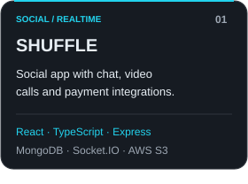
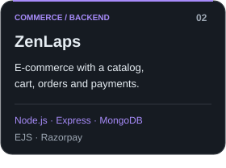
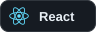
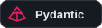

  

  <picture><source media="(prefers-color-scheme: dark)" srcset="https://readme-typing-svg.demolab.com?font=Fira+Code&amp;size=20&amp;duration=2800&amp;pause=1100&amp;color=22D3EE&amp;center=true&amp;vCenter=true&amp;width=640&amp;height=45&amp;lines=Building+backend+APIs;Crafting+full-stack+applications;Connecting+AI+to+real+workflows;Shipping+with+Kubernetes+%26+GitOps"></picture>

<strong>Full-stack Engineer · Backend · AI Integrations · Cloud</strong>

I build full-stack applications, backend APIs, and AI-powered integrations with Python and TypeScript. I enjoy connecting reliable services with thoughtful interfaces, and working with Kubernetes, containers, and GitOps to ship them.

  <a href="https://linkedin.com/in/muhammadali-jawhar-22a562228">LinkedIn</a> &nbsp; / &nbsp;
  <a href="https://leetcode.com/jauharp02">LeetCode</a> &nbsp; / &nbsp;
  <a href="https://instagram.com/mohd__jawhar">Instagram</a>

## 01 / Selected builds

  
  
  

  SHUFFLE: <a href="https://github.com/jauhar4563/SHUFFLE-Frontend">Frontend</a> / <a href="https://github.com/jauhar4563/SHUFFLE-Backend">Backend</a> &nbsp; · &nbsp;
  <a href="https://github.com/jauhar4563/ZenLaps">ZenLaps</a> &nbsp; · &nbsp;
  <a href="https://github.com/jauhar4563/GitHubApiProject">GitHub API Explorer</a>

## 02 / My engineering toolkit

Technologies I've worked with across personal projects and professional experience.

### Languages

  
  
  
  
  
  

### Frontend

  
  
  
  
  

### Backend

  
  
  
  
  

### Data & messaging

  
  
  
  
  

### AI integrations & data

  
  
  
  
  

### Cloud & platform

  
  
  
  
  
  
  

<strong>More tools, integrations &amp; experience</strong>

- **APIs & persistence:** REST/OpenAPI, WebSockets, GraphQL, SQLAlchemy, Alembic, TypeORM, Mongoose.
- **Identity & security:** Keycloak, OAuth, JWT, NextAuth/Auth.js, container security.
- **UI & interaction:** Firebase, shadcn/ui, Radix UI, Material UI, Bootstrap, Three.js, React Three Fiber.
- **Services & integrations:** Socket.IO, Stripe, Razorpay, ZEGOCLOUD, Cloudinary.
- **Operations & observability:** Nginx, Prometheus, OpenTelemetry, shell tooling.
- **Foundations:** data structures and algorithms in JavaScript.

## 03 / Build. Learn. Repeat.

<picture><source media="(max-width: 600px)" srcset="assets/generated/contributions-mobile.svg"></picture>

<picture><source media="(max-width: 600px)" srcset="assets/generated/streak-mobile.svg"></picture>

<!-- ACTIVITY:START -->
**1,746 contributions · 222 active days** 
Current streak: **0 days** · Longest in this window: **12 days** 
Period: 2025-11-01 to 2026-10-31 (UTC; refreshed daily).
<!-- ACTIVITY:END -->

Counts include anonymized private activity that GitHub makes visible. Streaks use UTC days; today's contributions can still arrive. The current streak includes a run ending yesterday and is limited to the displayed window.

<picture>
  <source media="(prefers-color-scheme: dark)" srcset="assets/generated/snake-dark.svg">
  
</picture>

  

Design &amp; widget credits

Layout inspiration: [DenverCoder1](https://github.com/DenverCoder1). Original banner, project cards, technology badges and activity cards are hosted in this repository. Animation: [Readme Typing SVG](https://github.com/DenverCoder1/readme-typing-svg) and [snk](https://github.com/Platane/snk). Technology icons: [Devicon](https://github.com/devicons/devicon) and [Simple Icons](https://github.com/simple-icons/simple-icons), embedded locally with licenses in `assets/icons/`. Profile hits: [Komarev](https://github.com/antonkomarev/github-profile-views-counter), a third-party request counter rather than unique visitors.

